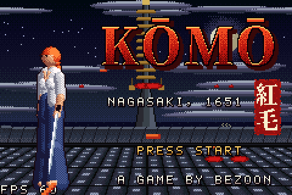
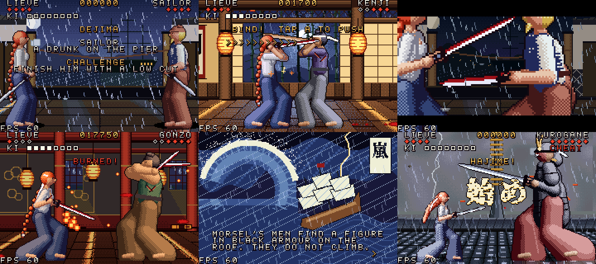
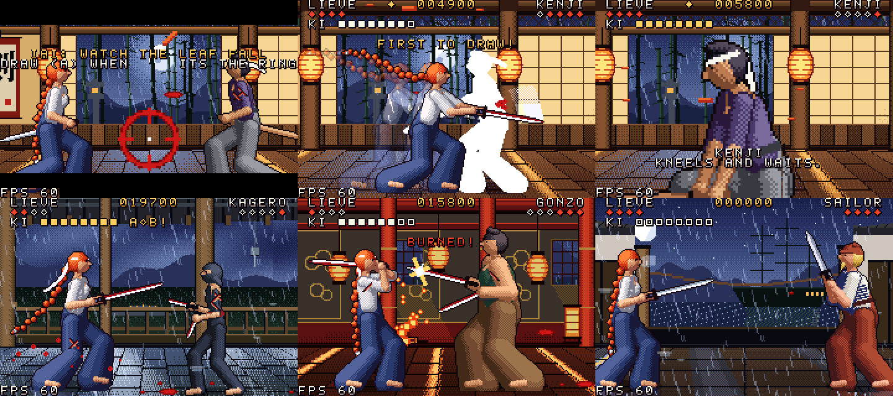

<p align="center"></p>

<h1 align="center">Kōmō 紅毛</h1>

<p align="center"><b>A Game Boy Advance duelling game. Nagasaki, 1651. One pagoda, five floors, five masters.</b><br>
<a href="https://bezoon5.github.io/Komo---GBA-Game/"><b>▶ Play it in your browser</b></a> ·
<a href="https://github.com/Bezoon5/Komo---GBA-Game/raw/main/play/komo.gba">Download the ROM</a> ·
<a href="https://bezoon5.github.io/Komo---GBA-Game/designer.html">Character designer</a></p>

---

**Kōmō** ("red hair") was the Edo-period Japanese word for the Dutch traders of Nagasaki. A giant in black armour has killed Pieter de Vries, the finest trader the Dutch company ever sent east. His daughter **Lieve**, red-haired and forbidden to set foot in Japan, follows the killer up a five-storey pagoda. Each floor is held by a master of a different fighting style.

It is a sword-duelling game in the spirit of Bushido Blade and the tower of a classic martial-arts film: big, hand-animated fighters, cuts at three heights, timed parries, seven planes of depth, and a story that changes with how honourably you fight.

<p align="center"></p>

## Features

- **Duels that reward reading your opponent.** Low, mid and high cuts; matching guards; parries that throw the attacker open; jumps, crouches, dodges, dashes, and sidesteps across seven planes. Cut or guard in the middle of a move.
- **Sword binds.** When two cuts meet, the blades lock and you push for the opening.
- **Seven opponents, seven stages.** A drunk sailor on the pier, a gatekeeper with a wooden sword, a monk with a staff, a twin-bladed brute, an assassin with knives in the rain, the giant on the storm roof, and a secret duel above the clouds.
- **Honour.** Return the bow, spare the beaten, don't strike the fallen. A spared master may return to help you, or for revenge. There is more than one ending.
- **Kurosawa moments.** Lightning silhouettes, the killing blow on black, a slow-motion replay of the final cut, a black-and-white defeat with a death poem.
- **Painted, weighted animation.** Every fighter is rendered from a posed skeleton with painted shading, realistic weight in each move, and cloth that swings.
- **Challenges, a gauntlet and time attack**, and saves at every floor.
- **Built for 60 FPS** on Game Boy Advance hardware, FPGA systems such as the Analogue Pocket, and emulators.

<p align="center"></p>

## How to play

| Button | Action |
|---|---|
| **A** | Cut. A A A chains three cuts. In a bind, tap A to push. |
| **Up, then A** | High cut |
| **Down + A** | Low cut |
| **B** (hold) | Guard: Up+B high, B mid, Down+B low. Press it just as a cut lands to parry. |
| **Up** | Jump: low and mid cuts pass under |
| **Down** (hold) | Crouch: high cuts pass over |
| **L / R** | Step one plane back / forward |
| **◀◀ / ▶▶** | Dodge / dash |
| **A + B** | Quick Draw, when the ki bar is full |
| **Start** | Pause |

A tutorial on the pier (on Rookie difficulty) teaches the basics.

### Where to play

- **In your browser:** the [web player](https://bezoon5.github.io/Komo---GBA-Game/) runs the game with [EmulatorJS](https://emulatorjs.org/) and the mGBA core. Saves stay in your browser. Keys can be changed from the gamepad icon in the player; controllers and touch screens work.
- **Analogue Pocket:** copy `komo.gba` to the folder your GBA core reads ROMs from and follow that core's setup (most GBA cores also need the official GBA BIOS, which isn't included here).
- **Emulators:** any accurate GBA emulator, for example [mGBA](https://mgba.io/) on desktop or Delta on iPhone.

## Building from source

The ROM is built from source: every sprite, stage, portrait and piece of music is generated by the Python tools, then compiled with Clang for the GBA's ARM7TDMI. No devkit is needed.

**Requirements** (Ubuntu 24.04 package names):

```sh
sudo apt install clang lld llvm python3 python3-numpy python3-pil \
                 fonts-noto-cjk fonts-noto-cjk-extra fonts-dejavu-core gcc
```

**Build:**

```sh
./build.sh
```

This writes `out/komo.gba` (about 11 MB) and `out/host_test`, a desktop test harness. See [docs/BUILDING.md](docs/BUILDING.md) for details, the harness and the character designer.

## Repository layout

| Path | What it is |
|---|---|
| `src/` | The game: `main.c` (the whole game), `crt0.s` (startup and the interrupt handler), `gba.ld`, `hw.h` |
| `tools/` | Asset generators: fighters (`fighters.py`), stages, music, the logo, the designer builder, `characters.json` |
| `host/` | The desktop harness: runs the game headless with a bot, takes screenshots, checks balance |
| `play/` | The web player (GitHub Pages): `index.html`, `komo.gba`, `designer.html` |
| `docs/` | Design notes, build notes and screenshots |

## Documents

- [Design doc](docs/DESIGN.md): every system, the campaign flow, engine notes
- [Building and testing](docs/BUILDING.md)
- [Changelog](CHANGELOG.md)
- [Contributing](CONTRIBUTING.md)
- [Third-party notices](THIRD_PARTY_NOTICES.md)

## Credits

Kōmō is a game by **Bezoon**. The Kurosawa references are an homage; no real people appear as characters.

## Licence

See [LICENSE](LICENSE). Third-party components are listed in [THIRD_PARTY_NOTICES.md](THIRD_PARTY_NOTICES.md).
